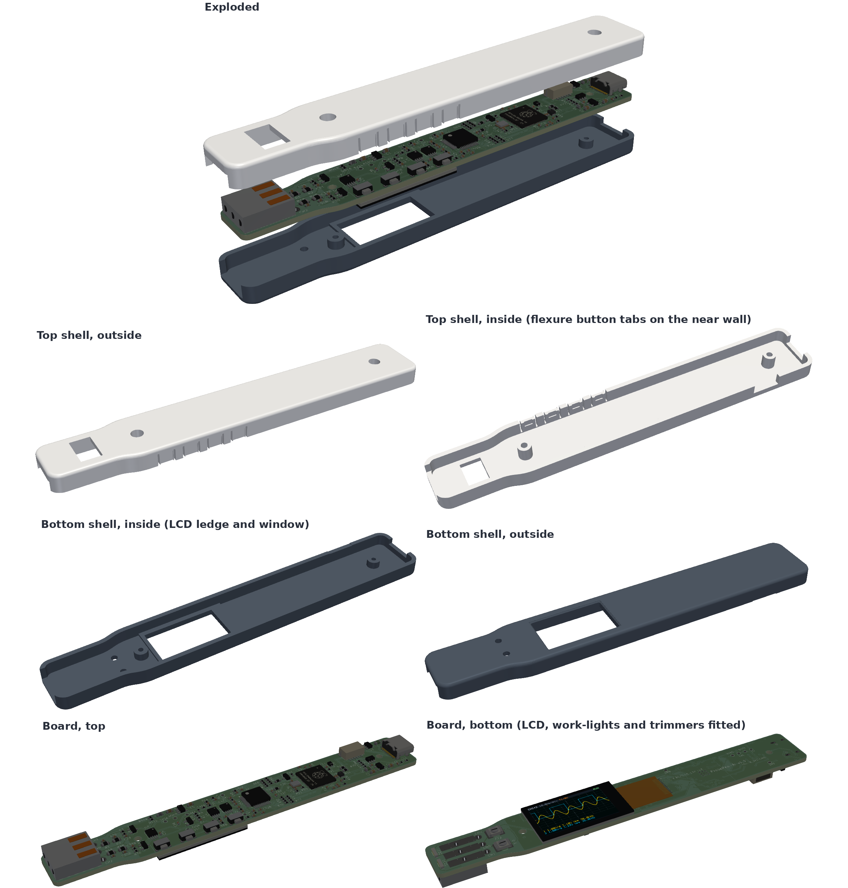

# ProbePen-AI

A USB-C pen-shaped two-channel oscilloscope built around an **RP2354B** and an **AD9288** dual 8-bit
ADC, with an IPS LCD on the underside, four side buttons, a 4-channel logic pod and a WAGO push-in
terminal at the nose for the two probe inputs. Everything (schematic, placement, routing,
fabrication files, case and firmware) is generated by scripts in this repository.

> **Status (2026-11-27):** re-laid out and fully routed on the `relayout` branch: KiCad DRC with
> schematic parity reports 0 errors and 0 unconnected items (the only warnings are the open ends of the
> In2 supply rails, by design), ERC is clean and all 149 offline tests pass. 2.5 m of track, 223 vias.
> About 160 mm of slow signals (gain-switch and DC-sense lines, two buttons, pod and LCD control) use
> the inner layers as jumpers, the longest 27 mm. The case fits the routed board, and the firmware
> has its full main loop and user interface (host-tested; not yet built against the Pico SDK).
> No board has been made or bench-tested yet.

**Try it in the browser: [ProbePen-AI simulator](https://clowrey.github.io/probepen-ai/).** The page runs the
firmware's own user interface (`firmware/src`, compiled to WebAssembly) on simulated probe signals. You
can press the side buttons, connect preset signals (UART, PWM, fast edges, glitches, over-range, a 12 V
rail, CAN FD, an SPI bus on the logic pod), and drive it from a host app over the real USB command
protocol: capture, measure, calibrate, stream continuously (with a USB budget you can set, to see where
samples start to drop), take deep records, and receive ASK snapshots. The simulated hardware is in [`sim/sim.c`](sim/sim.c).

| | |
|---|---|
| **MCU** | RP2354B (QFN-80, 0.4 mm pitch): dual Cortex-M33 at 150 MHz, 2 MB stacked flash, 12 PIO state machines, on-chip 1.1 V core buck (layout copied from the owner's CellKeeper board), 12 MHz crystal |
| **Scope ADC** | AD9288 (LQFP-48, hand-soldered, not placed by the assembler): two 8-bit channels, read by one PIO program as one 32-bit word per sample, clocked by PIO side-set at up to 75 MSPS (150 MHz / 2 / integer divider, set by the timebase) |
| **Front end** | Per channel: 940 kΩ (2 × 470 kΩ) with 1 pF into a 100 kΩ / 51 kΩ divider biased from the 3.000 V reference (rests at 0.978 V), BAV199 clamp, RS8752 buffer, RS8752 inverting gain stage pivoting on REF_MID (0.978 V), 74LVC2G66 gain switch. High range about ±5 V, low range about ±26 V |
| **References and supplies** | REF3030 (3.000 V), two RT9013-33 LDOs (`+3V3_DIG`, and `+3V3_ANA` behind a 600 Ω ferrite); the analog ground island joins digital ground at one 0 Ω link (R16) |
| **Logic pod** | 6-pin JST-SH side connector on GPIO0..3 (the 5 V tolerant pins), PTC-fused 3.3 V out, SRV05-4 ESD |
| **Display and buttons** | 13-pin 0.7 mm LCD flex soldered to pads on the bottom side (SPI1), AO3401A backlight switch; four side-actuated buttons (ASK, MODE/BOOTSEL, UP, DOWN); two front white work-light LEDs |
| **Board** | 138 × 17.6 mm, tapered to 14 mm at the nose, 4 layers (JLC04161H-7628), 1.6 mm, single-sided assembly on the top |
| **Case** | Two-piece build123d pen shell, 142 × 21.5 × 12.2 mm; screws self-tap into the plastic (no inserts) |

## Scope specifications

These figures come from the circuit values, the datasheets and the firmware as it is written today
(`firmware/src/app.c`, `main.c`). No board has been measured yet. Rows marked *possible* need a
firmware change but no hardware change.

| | |
|---|---|
| **Channels** | 2, sampled at the same instant (both AD9288 encode pins are driven from one MCU clock pin) |
| **Resolution** | 8 bits. One step is 39 mV on the ±5 V range and 214 mV on the ±26 V range |
| **Ranges** | ±5.0 V (high gain) and about ±26 V (low gain), chosen per channel, automatically or fixed. Auto-range switches up at 90 % of ±5 V or when the ADC reports over-range, and back down below 70 % |
| **Input** | About 975 kΩ, DC coupled. The divider is compensated (1 pF over 22 pF plus an optional 2–10 pF trimmer, `CT1`/`CT2`) |
| **Bandwidth** | Expected to be limited by the 31 MHz anti-alias filter (51 Ω × 100 pF) in front of the ADC. The 250 MHz RS8752 buffers are not the limit. Not yet measured |
| **Maximum sample rate** | 75 MS/s on each channel at once (150 MHz system clock ÷ 2 PIO cycles per sample). The AD9288-80 is rated to 80 MS/s, so overclocking the MCU to 160 MHz would give 80 MS/s (*possible*) |
| **One channel faster?** | No. Showing one channel (CH1 or CH2 mode) does not raise the rate, because both channels share one encode clock. Interleaving the two channels to 150 MS/s would need a second clock pin 180° out of phase and the same signal on both inputs: a board change |
| **Sample rate per timebase** | 100 ns/div to 1 µs/div: 75 MS/s. 2 µs: 25 MS/s. 5 µs: 10.7 MS/s. 10 µs: 5 MS/s. 20 µs: 2.4 MS/s. All rates are 75 MHz ÷ an integer, so there is no clock jitter from fractional dividers |
| **Peak detect** | At 50 µs/div and slower, the ADC keeps running at 2.5 MS/s. Every 4 to 2048 samples are reduced to a minimum and a maximum, so pulses of 0.4 µs or longer still show at 50 ms/div |
| **Record length (screen)** | 4096 samples per channel per capture (16 KB DMA buffer). Each capture holds about 4 screen widths, used for the trigger search: 512 samples (6.8 µs) at 100 ns/div, 3000 samples (40 µs) at 1 µs/div, about 2000 samples at slower timebases (0.8 ms at 20 µs/div, 0.4 s at 10 ms/div), and 4096 samples (1.7 s) at 50 ms/div |
| **Deep record** | `DEEP n [ch] [rate]`: one long record at 75 MS/s, or 75 MS/s ÷ an integer: **196,608 samples per channel with both channels (2.62 ms at 75 MS/s), or 393,216 with one (5.24 ms)**. Two PIO state machines run in lockstep, one per 8-bit bus, so each sample takes 1 byte (the screen capture spends a 32-bit word per sample pair). The 384 KB buffer is shared with the stream ring, the capture ring and the LCD framebuffer, since only one of them runs at a time. The firmware finds the trigger in the record, then sends it over USB in the stream's CRC-checked blocks: about 0.4 s for a full record at 1 MB/s. `host/probepen.py PORT deep [N] [CH] [RATE] [OUT]` saves it as CSV. Not yet run on a board |
| **Trigger** | Software trigger on the captured record: rising or falling edge, on CH1 or CH2, with 3 codes of hysteresis. The trigger point sits a quarter of the way across the screen, so 25 % of the screen is pre-trigger. If no edge is found, the display free-runs (like *Auto*) and the trigger label turns grey |
| **Trigger level** | Any 8-bit code, 0–255. Holding UP/DOWN moves it 4 codes at a time (157 mV on ±5 V, 0.86 V on ±26 V); the USB command `TRIG n` sets an exact code. It is drawn as a tick on the left edge and shown in volts in the header |
| **Trigger timing** | The trigger lands on the first sample past the level, with no interpolation between samples, so the trace can shift by up to one sample period (13.3 ns at 75 MS/s). Captures are taken back to back, and while a frame is being drawn and sent to the LCD (about 15–20 ms per frame, estimated), new edges are not seen. It is a display trigger, not a hardware trigger that catches every event |
| **Timing accuracy** | Set by the ±10 ppm 12 MHz crystal. The frequency readout averages every crossing in the record, so its error is about one sample period divided by the record's duration |
| **Voltage accuracy** | Offset: `CAL` with both tips on AGND zeroes both ranges of each channel separately, and the result is stored in flash. Gain: uncalibrated, the result depends on 1 % resistors, the 0.2 % REF3030 and the AD9288's own gain error, so expect a few percent. A two-point gain calibration routine exists (`afe_calibrate_two_point`) but no command is wired to it yet. Linearity is about ±½ LSB typical (AD9288 datasheet) |
| **DC meter mode** | Reads each gain stage through the RP2354B's 12-bit ADC (`CHx_DC_SENSE`, 10 kΩ / 10 nF), slow but finer than the 8-bit scope ADC, plus VBUS |
| **Logic pod** | 4 inputs (5 V tolerant), sampled at the scope's rate for the timebase, up to 75 MS/s, 4096 samples. Shows each line's level and edge count |
| **USB capture** | Full speed (12 Mbit/s) CDC serial. `CAPTURE n` (up to 4096) or a long press of ASK sends the last capture of both channels as framed binary with a CRC, 16 bits per sample: a full 2 × 4096 record is 16 KB |
| **USB streaming** | `STREAM rate [ch]` sends continuous 8-bit samples until `STREAM 0` or any button: any rate from about 1 S/s to 75 MS/s per channel, CH1, CH2 or both interleaved. The ADC runs at 75 MHz ÷ an integer. Below 1144 S/s the firmware averages several raw samples into each one, which gives less noise and finer resolution. The samples go out in 1 KB blocks with a CRC. Each block carries the index of its first sample, so the host sees exactly how many samples were lost if it falls behind. The pen shows the rate, the USB throughput and any losses on its screen. The USB serial buffer is raised from TinyUSB's 64 bytes to 4 KB for this. **Throughput:** a full-speed link carries at most 1.216 MB/s (19 packets of 64 bytes per millisecond); 0.8–1.1 MB/s is typical in practice. That gives about **1 MS/s on one channel, or 500 kS/s on each of two**, without losses. Faster rates still run, with the gaps marked. Not yet measured on a board; the simulator models the link as 1 MB/s. `host/probepen.py PORT stream RATE [CH] [SECONDS] [OUT]` records a stream and reports what it measured |

## Decoding protocols on the pen

Streaming raw samples is limited by USB to about 1 MB/s. Decoding a bus on the pen sends only the
result: CAN frames, I²C transactions or UART bytes are a few kilobytes per second even on a busy bus.
The firmware is open and built for this kind of change. The user interface, capture processing and
streaming are plain C that compiles and is tested on a PC. A new decoder is a small module of the
same kind: samples in, decoded messages out. It can be tested on recorded or synthetic signals, run
in the [web simulator](https://clowrey.github.io/probepen-ai/), then flashed by drag-and-drop
(hold MODE/BOOTSEL while plugging in). None of the decoders below exist yet; this section sets out
what the hardware allows.

**Two ways to decode.**
- **Live:** one RP2354B core thresholds each sample and runs the bus state machine while the other
  core keeps USB and the screen going. In plain C that is roughly 15–30 CPU cycles per sample, so
  about **5–10 MS/s** can be decoded continuously (an estimate until it is measured). With 5–10
  samples per bit, that covers buses up to about **1 Mbit/s**, every frame, indefinitely.
- **Burst:** capture at up to 75 MS/s into RAM, then decode at leisure. Speed is no limit here, but
  the record length is: the deep record (`DEEP`) holds 196 k samples per channel (2.6 ms at
  75 MS/s), or 393 k for one channel (5.2 ms). Each burst catches one or more frames, and some frames
  between bursts are missed.

The two analog channels take the same signal at the same instant. Subtracting one from the other
decodes differential buses (CAN, RS-485) as the receiver sees them, and also shows each wire's
levels, which a logic analyser cannot. The logic pod's four 5 V-tolerant lines can be decoded by a PIO
state machine directly, without the CPU touching each sample.

| Bus | Bit rate | Connect | Live | Burst |
|---|---|---|---|---|
| **CAN 2.0** | 125 k–1 Mbit/s | CH1 = CAN_H, CH2 = CAN_L, AGND = bus ground; decode CH1 − CH2 (2 V dominant = 51 codes on ±5 V) | yes, at 4–8 MS/s: every frame | yes |
| **CAN FD** | arbitration ≤ 1 Mbit/s, data 2, 5 or 8 Mbit/s | same | no: the data phase needs ≥ 40 MS/s per channel | **yes, up to 8 Mbit/s** (9.4 samples per bit at 75 MS/s; the 31 MHz input filter's 11 ns rise time is well inside a 125 ns bit). A 64-byte frame lasts about 0.2 ms at 5 Mbit/s (15 k samples) and 0.4 ms at 2 Mbit/s: a deep record holds several. The simulator's "CAN FD 500k / 2M" preset shows this |
| **I²C** | 100 k, 400 k, 1 MHz (Fm+), 3.4 MHz (Hs) | CH1 = SDA, CH2 = SCL; also shows the pull-up rise times | 100–400 kHz yes; 1 MHz probably (about 10 MS/s) | all, including 3.4 MHz (22 samples per bit) |
| **UART, RS-232, RS-485, LIN** | to 1 Mbaud live, about 10 Mbaud burst | one tip per line (RS-232's ±12 V and LIN's 12 V fit the ±26 V range); RS-485 as CH1 − CH2 | yes | yes |
| **SPI, quad SPI** | to about 20 MHz | logic pod: CS, SCK, MOSI, MISO, read by PIO on the clock edges | yes (PIO) | yes |
| **1-Wire, WS2812, DShot, IR, PWM, SENT, Manchester** | ≤ 1 Mbit/s | one tip or a pod line | yes | yes |

The analog inputs can also decode analog encodings that a logic analyser cannot see: amplitude and
frequency keying, DTMF and modem tones, PWM duty as a value, sensor pulse amplitudes, video sync, and
eye-pattern or rise-time checks on any of the buses above. The pen is not isolated: its ground is the
USB host's ground, so connect AGND to the circuit's ground first.

## How it works

The signal runs nose to tail. The two probe inputs enter at the WAGO terminal (`J5`), pass the
high-voltage dividers, clamps and buffers on the analog ground island, and reach the ADC (`U2`) at
x ≈ 71 mm. Its two 8-bit data buses run to the MCU (`U1`, x ≈ 94.5 mm) in pin order, so they never
cross. The LCD bus, buttons, sense lines and logic pod connect to the MCU's other sides, and USB-C
sits at the tail.

- **Front end.** 0 V at a tip sits at ADC mid-scale on both ranges, because the gain stages pivot on
  the same voltage the dividers rest at (`REF_MID`). The input buffer accepts 0.05 to 2.2 V, which
  sets the usable ranges. The gain stage inverts; the firmware flips the codes back. A floating tip
  sits at about +1 V (the divider bias) but reads 0 V, and a grounded tip sources about 1 µA into the
  circuit under test. The full wiring list is
  [`hardware/SCHEMATIC_WIRING_SPEC.md`](hardware/SCHEMATIC_WIRING_SPEC.md), generated from `hw/design.py`.
- **ADC capture.** `ADCA_D7..D0` are on GPIO16..23 (bit-reversed, to keep the bus uncrossed) and
  `ADCB_D0..D7` on GPIO32..39, so with the PIO GPIO base at 16 a single `in pins, 32` reads both
  channels. `ADC_CLK` (GPIO24) is driven by side-set.
- **DC sense.** Each channel's gain-stage output also feeds an RP2354B ADC input (GPIO40, GPIO42)
  through 10 kΩ and 10 nF, for a slow DC reading. `VBUS_SENSE` is on GPIO46.

## Circuit board

The layout rules (inner layers, vias, widths, critical nets, the MCU fan-out) are written down in
[`docs/ROUTING_GUIDE.md`](docs/ROUTING_GUIDE.md). In short:

- **Stackup:** `F.Cu` parts and signals; `In1.Cu` ground (GND, with the AGND island under the front
  end); `In2.Cu` ground plus the supply rails as wide tracks (`hw/rails.py`); `B.Cu` signals, the LCD
  pads and a 3.3 V pour under the MCU.
- **Vias:** 0.40 / 0.25 mm everywhere (JLC's standard via: 0.20 mm drills cost about $40 more per order), none in pads, 0.25 mm hole-to-copper (JLC lists 0.254 mm
  via-to-track for multilayer boards).
- **Nose:** no copper pours under the probe pads and dividers and no inner-layer copper there; one
  planned AGND trace ties the terminal, LEDs and tip capacitors back to the analog ground island.
- **MCU:** the core regulator (switch node, inductor, input and output capacitors, local pours and
  the inner-layer cut-out) is copied from CellKeeper. Inside the pad ring only supply and ground
  tracks are allowed, as a board rule that KiCad's DRC checks. Slow pins fan out with a short stub
  to a via just outside the chip.

### How it is routed

1. `hw/design.py` → `hw/gen_sch.py` → `hw/gen_pcb.py`: circuit, schematic, placement and zones.
2. `hw/tools/plan_routes.py … critical`: a grid planner in this repo lays the nets whose geometry
   matters (front end, USB pair, crystal, ADC buses, supply-rail vias, MCU fan-out) together with
   the fixed escapes in `hw/escapes.py`. These are locked.
3. `hw/tools/groute/run.sh`: the open-source router
   [KiCadRoutingTools](https://github.com/drandyhaas/KiCadRoutingTools) routes the rest one group of
   nets at a time (`route.py --nets …`), each group with its own layers and keep-outs. Several group
   orders run in parallel and the best is kept. Supplies and grounds follow; the router's few
   too-close vias are nudged clear, and stranded pour pieces get a stitching via
   (`hw/tools/stitch_islands.py`).
4. The result is frozen into `hw/routes.py`, and `hw/route.py` rebuilds the board from it.

## Case

[`case/case.py`](case/case.py) builds the two-piece pen shell in build123d from
[`hw/out/board_features.json`](hw/out/board_features.json), so every opening follows the board.
Screws self-tap into pilot holes in the plastic; there are no heat-set inserts.

Every part on the board has a 3D model: the RP2354B, USB-C and inductor use vendor STEP files, and the
rest are built in build123d from each footprint's pads (`hw/gen_3d.py`), including the hand-fitted
AD9288, LCD, work-lights and trimmers, which the renders show fitted.

- The outline follows the board, including the 14 mm nose and its S-curve taper.
- The nose has a front window over the WAGO wire entries and the two work-light LEDs, and a window
  on top over the terminal's release push-buttons.
- The LCD sits on the bottom of the board, so its viewing window is in the bottom shell, with a
  ledge under the glass rim.
- Each side button gets a flexure tab cut into the side wall that presses the switch plunger.
- Two holes in the bottom shell reach the input trimmer capacitors.
- The 12.2 × 21.5 mm cross-section is set by the WAGO terminal (4.5 mm tall) on top and the LCD glass
  below.

Printing: `case/out/top_shell.stl` and `bottom_shell.stl`, each with its flat outer face on the bed
(the top shell upside down), no supports. Walls are 1.6 mm (four 0.4 mm perimeters). Two M2 × 8 mm
pan-head self-tapping screws hold it together through the board's mounting holes.

## Input limits and safety

The instrument is referenced to USB ground; it is not isolated. Keep both probe inputs within about
±26 V on the low range and ±5 V on the high range, and never connect it to mains or to circuits that
are not referenced to the USB host's ground.

## Connectors and test pads

| Ref | Part | Use |
|---|---|---|
| `J1` | USB-C (HRO TYPE-C-31-M-12) | power, USB full speed, 5.1 kΩ CC pull-downs |
| `J3` | JST-SH 6-pin, side | logic pod: 1 GND, 2 fused 3.3 V, 3..6 POD_CH0..3 |
| `J4` | LCD flex pads, 13-pin 0.7 mm, bottom side | IPS panel on SPI1 (CS, RST, DC, SCK, MOSI, backlight) |
| `J5` | WAGO 2060 3-pole, nose | CH1, AGND, CH2 |

Test pads: `TP_5V`, `TP_3V3D`, `TP_3V3A`, `TP_3V0R`, `TP_1V1`, `TP_GND1`, `TP_GND2`, `TP_AGND`,
`TP_BOOT`, `TP_CH1`, `TP_CH2`, `TP_REFM`. This revision has no SWD or RUN pads: the MCU is programmed
over USB (hold MODE/BOOTSEL), and the pads had no room beside the crystal and the LCD lines.

## Firmware

[`firmware/`](firmware/) is C11 with two PIO programs:

- [`ad9288_capture.pio`](firmware/ad9288_capture.pio): one sample per two PIO cycles, both channels
  in one word, moved to RAM by DMA; `scope_unpack_ad9288()` splits them and bit-reverses channel A.
- [`pod_capture.pio`](firmware/pod_capture.pio): the four pod inputs on GPIO0..3, eight 4-bit samples
  per word.
- [`src/main.c`](firmware/src/main.c): one capture is always in flight (PIO + DMA); meanwhile the
  loop reads the buttons, the DC-sense ADC and the USB command line. Each finished capture is
  measured, drawn, and sent to the LCD over SPI1 with 16-bit DMA. At 50 µs/div and slower the scope
  runs in peak detect: the ADC keeps sampling at 2.5 MS/s into a DMA ring and the loop keeps the
  minimum and maximum of each slot, so pulses and fast signals still show at slow timebases
  instead of aliasing.
- [`src/app.c`](firmware/src/app.c): the whole user interface, with no hardware calls, so it runs and
  is tested on the host. It holds the modes, timebases (integer PIO dividers, 100 ns to 50 ms/div),
  trigger, auto-ranging, button debounce and long-press, USB commands and screen drawing.
- Other host-testable modules: front-end calibration (8-bit codes, mid-scale 128), trigger and
  measurement, LCD (5×7 font; 1.14" ST7789 by default, `-DPROBEPEN_LCD_096` for the 0.96" ST7735),
  logic helpers and a framed USB protocol.

The screens above are the firmware's own drawing code fed synthetic captures
(`.venv/bin/python docs/fw_ui_preview.py`): both channels, one channel, logic pod and DC meter.

| Button | Short press | Held |
|---|---|---|
| ASK | run / hold | send the measurements and the screen's samples to the host (`ASK …` line + frames) |
| MODE | next mode: CH1+2, CH1, CH2, LOGIC, METER | trigger source and slope |
| UP / DOWN | slower / faster timebase | trigger level up / down (repeats) |

USB (CDC serial, one command per line): `*IDN?`, `MODE n` (0..4), `TB n`, `GAIN 0|1|10` (0 = auto
range), `TRIG code`, `RUN 0|1`, `CAL` (zero the offsets with the inputs shorted; kept in the last flash sector), `MEAS?`, `CAPTURE n`
(replies `OK n`, then one binary frame per channel: `AA 55 seq count16 samples16… crc16`).
`STREAM rate [ch]` replies `OK RATE= RAW= DIV= AVG= CH= BPS= LSB1= ZERO1= LSB2= ZERO2=` (volts =
(code − ZERO) × LSB) and then streams blocks `A5 5A flags ch len16 first_index32 payload crc16` until
`STREAM 0` or a button, ending with a `STREAM END …` summary line (see
[`probepen_stream.h`](firmware/include/probepen_stream.h)). `DEEP n [ch] [rate]` (n 0 = as long as fits)
replies `OK N= CH= RATE= DIV= SECONDS= LSB1= ZERO1= LSB2= ZERO2=`, takes the record, and sends
`DEEP DATA N= TRIG=`, the record in the same blocks, and `DEEP END`
([`probepen_deep.h`](firmware/include/probepen_deep.h)).
[`host/probepen.py`](host/probepen.py) speaks this protocol from a PC: `idn`, `meas`, `capture N`
(CSV), `send "<command>"`, `stream RATE [CH] [SECONDS] [OUT]` (prints the bytes per second, samples per
second and losses it measured; writes CSV volts or raw bytes), `deep [N] [CH] [RATE] [OUT]`, and `ask`, which waits for ASK presses
and returns each snapshot for an assistant to look at.

`firmware/include/probepen_pins.h` is generated from the GPIO map in `hw/design.py`
(`python -m hw.tools.gen_pins_h`), and the tests check it against that map. The firmware builds
against Pico SDK 2.2.0 (87 KB of code, 434 KB of the 520 KB RAM, most of it the 384 KB record buffer):
`cmake -S firmware -B build -G Ninja -DPICO_SDK_PATH=...` then `ninja -C build` gives
`probepen_fw.uf2`. The tests also compile every source natively and for Cortex-M33, and type-check
the hardware code path against the SDK 2.x signatures (`tests/fw_stubs`).

To check on the first board:

- The LCD window offsets and orientation (`LCD_X_OFFSET`, `LCD_Y_OFFSET`, `MADCTL`).
- The DC-sense scaling against a meter.
- ADC capture at 75 MS/s (`TB 0`) with a known ramp. The PIO reads the bus through the input
  synchronisers about two system clocks late, so look for bit errors. If there are any, try input
  sync bypass on GPIO16-23 and 32-39 or a slower top rate.
- `OVR` on the screen (or `OVR=YES` in `MEAS?`): the capture lost samples, either a stalled PIO FIFO
  or peak detect falling behind its DMA ring.
- The RP2354 stepping. On A2 parts, erratum E9 can latch a pad with its pull-down on, so the firmware
  turns the pod inputs' pulls off; floating pod inputs then read noise.
- That a UF2 drag-and-drop leaves the stored calibration alone. It sits one sector below the top of
  flash, away from picotool's 0x10FFFF00 block.

| GPIO | Signal | GPIO | Signal |
|---|---|---|---|
| 0..3 | POD_CH0..3 | 24 | ADC_CLK (side-set) |
| 5 | BTN_ASK_AI_N | 25, 26, 27 | LCD_CS_N, LCD_RST_N, LCD_DC |
| 9 | LCD_BLK_GATE_N | 30, 31 | LCD_SCK, LCD_MOSI (SPI1) |
| 10, 13 | CH1_GAIN_LO, CH2_GAIN_LO | 32..39 | ADCB_D0..D7 |
| 14, 15 | ADC_S1, ADC_S2 | 40, 42 | CH1_DC_SENSE, CH2_DC_SENSE (ADC0, ADC2) |
| 16..23 | ADCA_D7..D0 | 43, 44, 45 | BTN_DOWN_N, BTN_UP_N, BTN_MODE_N |
| | | 46 | VBUS_SENSE (ADC6) |

## Ordering

`hw/export_jlc.py` writes the Gerbers, BOM and placement file for JLCPCB assembly to
[`hw/out/jlc/`](hw/out/jlc/), and [`cost.md`](hw/out/jlc/cost.md) with live JLC prices and stock.

**Checked on JLCPCB's own order page (2026-11-27), for 30 boards.** The Gerbers, BOM and CPL were
uploaded and taken through to the cart, but not ordered.

| | |
|---|---|
| PCB: 4 layers, 138 × 17.6 mm, JLC04161H-7628, 0.2 mm vias (the quoted design; now 0.25 mm, see below) | $73.53, of which the 0.2 mm via costs $18.35 plus a $17.51 four-wire Kelvin test and $3.67 for Tg155, all added automatically |
| Economic assembly, top side, 42 part types | $198.16: parts $130.82, Extended-part fees $37.08, SMT $19.15, setup and stencil $9.79, nitrogen reflow $1.32 |
| Shipping (estimate) | $42.20 |
| **Total** | **$307.89 after a $6 coupon, about $10.26 per board** |

- **Not in the assembled price:** the AD9288 and the LCD (hand-soldered; see below for where to buy
  the AD9288), and the WAGO 2060 terminal. JLC places the WAGO only with Standard assembly, which costs
  $25 more per side and adds 5 mm edge rails. It is a large-pad SMD part that is easy to hand-solder;
  LCSC C2765056 costs about $0.43.
- **Part orientation was checked in JLC's placement viewer.** Pin 1 of each part was compared with
  the footprint's pad 1 and silkscreen marker. Five package types were wrong in the first placement
  file and are corrected in `hw/parts.py` (`rotation`):
  - SOT-23 (BAV199, REF3030, AO3401A): 180°
  - SOT-23-5 (RT9013): 270°
  - SOT-23-6 (SRV05-4): 270°
  - MSOP-8 (RS8752): 270°
  - TSSOP-8 (74LVC2G66): 180°

  The RP2354B, crystal, SOD-323 Schottky, USB-C and side switches were already right. JLC has no 3D
  model for the logic pod's JST connector (J3). Choose "Confirm Parts Placement: Yes" when ordering,
  so JLC's engineers check it.
- **JLC's matcher** leaves BOM lines with letter-suffixed designators (C32B, R25A, …) unticked
  ("there may be multiple types of parts"). They are the right parts: tick them.
- **Vias changed to a 0.25 mm drill after this quote.** The 0.40 mm pads now meet JLC's standard
  0.25 mm via option (pad at least drill + 0.10 mm, 0.15 mm preferred). That drops the via,
  Kelvin-test and Tg155 charges. DRC is clean with a 0.075 mm annular-ring rule.

**AD9288 sources (2026-11-27).** It is in production at Analog Devices, which lists it as
pin-compatible with the 10-bit AD9218.

| Source | Part | Price | Stock |
|---|---|---|---|
| LCSC C514284 | AD9288BSTZ-80 | $10.62 for 1, $9.10 from 10, $8.21 from 30 | 249 |
| LCSC C31151 | AD9288BSTZ-100 | $12.81 | 20 |
| JLC library | AD9288BSTZ-80 | $10.53, so JLC can place it | |
| Digi-Key | AD9288BSTZ-80 | about $24 each at 10 | 36 |
| Mouser | AD9288BSTZ-80 | about $20 each at 10 | 2 |

AliExpress listings at $1–4 are well under ADI's own price and are likely remarked or pulled parts.
No Chinese pin-compatible equivalent turned up; the -40 grade is too slow for 75 MS/s. The cheapest
reliable route is to let JLC place C514284: drop the DNP on U2 and add it to the BOM, for about
$10.53 a board plus one Extended-part fee.

## Building it from source

In WSL (Ubuntu) with KiCad 10 (`kicad-python`, `kicad-cli`), the project `.venv` (build123d,
pytest), `gcc` and `arm-none-eabi-gcc`:

| Step | Command |
|---|---|
| Schematic | `.venv/bin/python -m hw.gen_sch` |
| 3D models of the parts (build123d) | `kicad-python hw/tools/dump_fp_geometry.py && .venv/bin/python -m hw.gen_3d` |
| Board placement and zones | `kicad-python hw/gen_pcb.py` |
| Board from the frozen routing | `kicad-python hw/route.py` |
| Re-route from scratch | `KRT=<KiCadRoutingTools checkout> hw/tools/groute/run.sh` |
| Pin header for the firmware | `.venv/bin/python -m hw.tools.gen_pins_h` |
| Case | `.venv/bin/python case/case.py` |
| Images | `kicad-python docs/render_board.py`, then `docs/make_images.py`, `docs/fw_ui_preview.py`, `docs/case_views.py`, `docs/composite.py` (each with `.venv/bin/python`) |
| Web simulator | `sim/build.sh` (clang, lld and wasi-libc; writes `sim/site/probepen.wasm`, which is committed and published by `.github/workflows/pages.yml`) |
| Tests | `.venv/bin/pytest -m "not net"` |

## Licence

GPL-3.0: hardware design files, CAD, firmware and scripts alike. See [LICENSE](LICENSE).
