# ProbePen-AI

A USB-C pen-shaped mixed-signal instrument built around an **RP2354B** and an **MS9280** 10-bit ADC:
a 35 MSPS oscilloscope, a DC voltmeter, an adjustable-threshold logic probe (**TLV3501**), and a
4-channel logic pod, with a 0.96" 80 × 160 IPS LCD and two trigger/mode buttons. Designed as a
fully script-generated 4-layer JLCPCB PCBA board inside a two-piece **build123d** pen clamshell.

  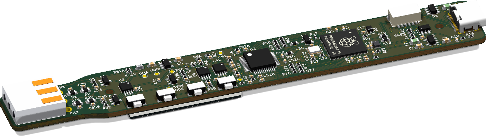
  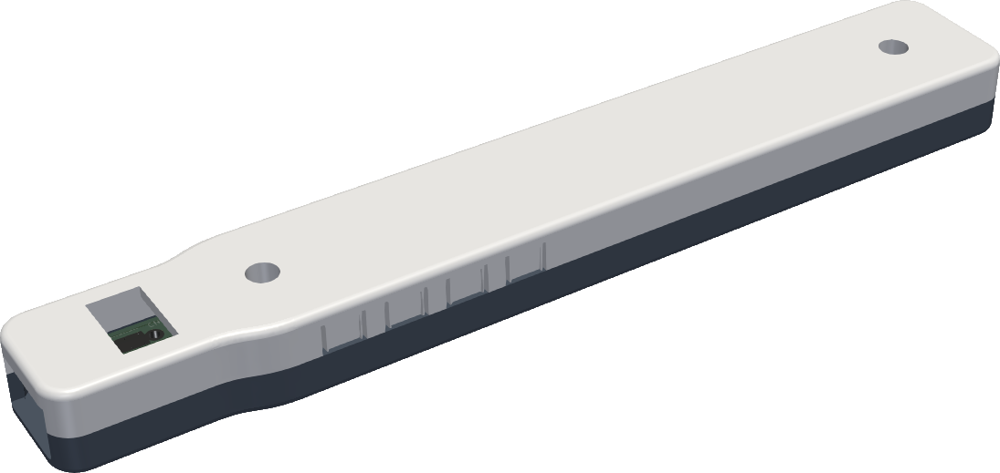

> **Status:** Schematic, parts catalogue, PCB placement, JLC export files, **build123d** pen
> enclosure, and C11/PIO firmware are all generated by scripts and verified by 151 automated tests
> (ERC clean, 0 schematic parity issues, STEP/Gerber/BOM/CPL checks, enclosure fit/clearance checks,
> native `gcc` `ctypes` unit tests, and `arm-none-eabi-gcc` Cortex-M33 cross-compilation). No boards
> have been manufactured or bench-tested yet, and Stage 4 automated routing (`hw/route.py`) still
> has 16 remaining unrouted connections and drill-to-copper `hole_clearance` items to resolve
> before sending Gerbers to fabrication.

| | |
|---|---|
| **MCU** | RP2354B (QFN-80): dual Cortex-M33 @ 150 MHz, 4 MB internal stacked flash, 12 PIO state machines, on-chip 1.1 V core buck, 12 MHz crystal |
| **Scope ADC** | MS9280 (SSOP-28): 10-bit parallel CMOS output, clocked by PIO0 side-set up to 35 MSPS (`ADC_CLK` + `ADC_D0..D9`) |
| **Analog Front End** | 1 MΩ compensated divider (2 × 470 kΩ + 1 pF C0G, `BAV199` clamp), dual `OPA356` wideband buffers, `RS2227XN` 1× / 10× analog mux, `REF3030` 3.000 V reference + −1.8 V negative rail (`LM2776` + `TPS72301`) |
| **Logic Probe** | `TLV3501` 4.5 ns rail-to-rail comparator fed by filtered RP2354B PWM DAC threshold (`0..3.0 V` for TTL, CMOS 3.3 V, 1.8 V, or custom mV) |
| **4-Ch Logic Pod** | Side 6-pin JST-SH (`SM06B-SRSS-TB`), 500 mA resettable PTC, 220 Ω + `SRV05-4` ESD clamp, `SN74LV4T125` level translator into PIO1 (`GPIO17..20`) |
| **Display & UI** | 0.96" FP-096H09A 80 × 160 IPS LCD over SPI0 (8-pin Molex `503480-0800` FPC, `AO3401A` high-side PWM backlight), 2 × `TS-1187A` buttons (`ASK_AI`, `MODE/BOOTSEL`), 2 × `WS2812B-2020-V6` LEDs |
| **Power & USB** | USB-C (`TYPE-C-31-M-12`), `500 mA` PTC fuse, `SRV05-4` ESD, dual `RT9013-33` LDOs (`+3V3_DIG` / `+3V3_ANA`) |
| **Board** | 132 × 15 mm, 4 layers (`JLC04161H-7628`: `F.Cu` / `In1.Cu` GND+AGND / `In2.Cu` / `B.Cu`), single-sided top SMT assembly |
| **Case** | Two-piece `build123d` pen shell (`top_shell` + `bottom_shell`), clamped with M2 screws self-tapping into 1.7 mm bottom bosses |
| **Cost** | About **$17.44** / board for 30, **$13.67** / board for 100 assembled (live LCSC pricing + estimates, [below](#ordering-at-jlcpcb)) |

**Contents:** [How it works](#how-it-works) · [Schematic](#schematic) · [Circuit board](#circuit-board) ·
[Case](#case) · [Input limits & safety](#input-limits-and-safety) · [Connectors & test pads](#connectors-and-test-pads) ·
[Firmware & calibration](#firmware-and-calibration) · [Ordering at JLCPCB](#ordering-at-jlcpcb) ·
[Building from source](#building-it-from-source)

## How it works

The signal path runs nose-to-tail: high-impedance analog circuitry sits inside the isolated **`AGND`
island** near the M3 stainless probe tip, while high-speed ADC data buses, logic pod buffers, display
SPI, and USB live on the digital **`GND` plane**, joined at a single 0 Ω star bridge (`R16`).

- **Power & Star Ground:** VBUS (`+5V_VBUS`) enters at `J1` through a `500 mA` resettable PTC (`F1`)
  and `SRV05-4` ESD array (`D1`). Two separate `RT9013-33` LDOs isolate digital (`U9` `+3V3_DIG`) and
  analog (`U10` `+3V3_ANA` via `600 Ω` ferrite bead `FB1`) supplies. An `LM2776` switched-capacitor
  inverter (`U11`) followed by a low-noise `TPS72301` LDO (`U12`) generates `-1.8 V` (`-1V8_ANA`) so
  the op-amp stages handle bipolar swings symmetrically around AGND. Digital `GND` and analog `AGND`
  are split on `In1.Cu` and joined only at `R16`.
- **Analog Front End (AFE):** The threaded `J2` M3 probe tip feeds two series `470 kΩ` `0805` 100 ppm
  Basic resistors (compensated by `1 pF` C0G `C33`) into a `BAV199` low-leakage rail clamp (`D4`).
  An `OPA356` unity-gain buffer (`U3` / `U4`) drives the `TLV3501` comparator directly (`V_BUF`) and
  feeds a `1×` / `10×` `RS2227XN` analog switch (`U6`) biased from a `REF3030` `3.000 V` precision
  reference string (`U5`) to map `±2.5 V` (1×) or `±25 V` (10×) cleanly into the `1.000 V ± 0.500 V`
  input window of the MS9280 (`V_ADC`). Firmware 2-point self-calibration (`afe_calibrate_two_point`)
  calibrates out the 1% / 100 ppm Basic divider tolerance in software, avoiding expensive thin-film arrays.
- **High-Speed 10-Bit Scope ADC:** `U2` (`MS9280`) outputs all 10 parallel bits (`ADC_D0..D9`)
  through `33 Ω` series damping resistors (`R26..R35`) directly into RP2354B `GPIO0..GPIO9`, clocked by
  `GPIO10` via PIO0 side-set. Autopush packs three 10-bit samples per 32-bit FIFO word over DMA into
  RAM at up to 35 MSPS without CPU intervention.
- **Logic Probe & 4-Channel Pod:** `U7` (`TLV3501`) compares the buffered tip voltage against a
  2-stage RC-filtered PWM DAC (`COMP_THR_PWM` on `GPIO32`, readable back on `GPIO41` ADC1) and feeds
  `COMP_OUT` (`GPIO16`). Side connector `J3` brings in 4 digital channels protected by a `500 mA` PTC,
  `220 Ω` series resistors, `SRV05-4` ESD clamp, and `SN74LV4T125` buffer (`U8`) into PIO1 (`GPIO17..20`).
- **Display & Controls:** An 8-pin bottom-contact Molex FPC (`J4`) drives the 0.96" 80 × 160 `ST7735S`
  IPS panel over `SPI0` (`GPIO21..25`) with `AO3401A` P-MOSFET PWM backlight control (`GPIO26`).
  `SW1` (`ASK_AI`, `GPIO29`), `SW2` (`MODE/BOOTSEL`, `GPIO30` + Schottky `D6` to `QSPI_SS_N`), and two
  `WS2812B-2020` RGB status LEDs (`LED1`/`LED2`, `GPIO28`) sit along the finger grip behind the nose.

## Schematic

The complete schematic is in [`hw/out/schematic.pdf`](hw/out/schematic.pdf) (KiCad 10:
[`hw/probepen_ai.kicad_sch`](hw/probepen_ai.kicad_sch)). It is generated directly from
[`hw/design.py`](hw/design.py) by [`hw/gen_sch.py`](hw/gen_sch.py), organized into eight functional
blocks connected by global net labels.

[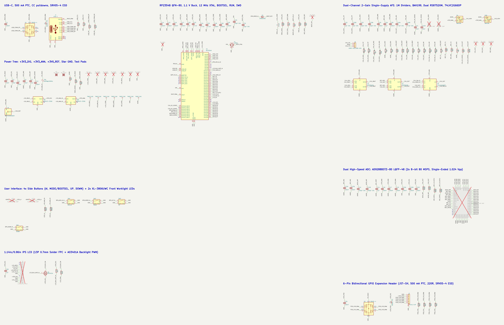](hw/out/schematic.pdf)

<b>Each schematic section, larger</b>

**Analog Front End:** 1 MΩ compensated divider, `BAV199` clamp, `OPA356` buffers, `RS2227XN` 1×/10× gain switch

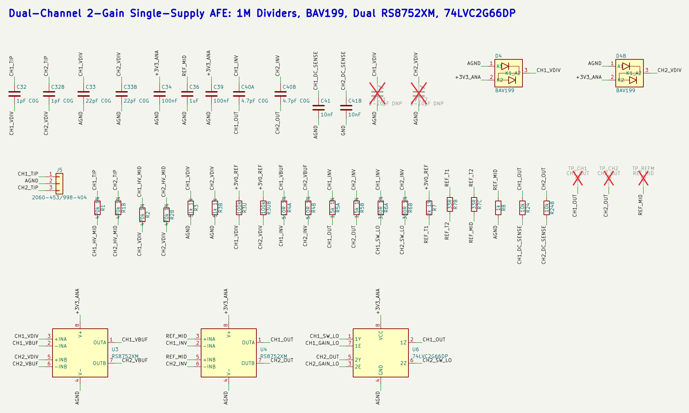

**High-Speed ADC:** `MS9280` 10-bit parallel ADC + series damping resistors

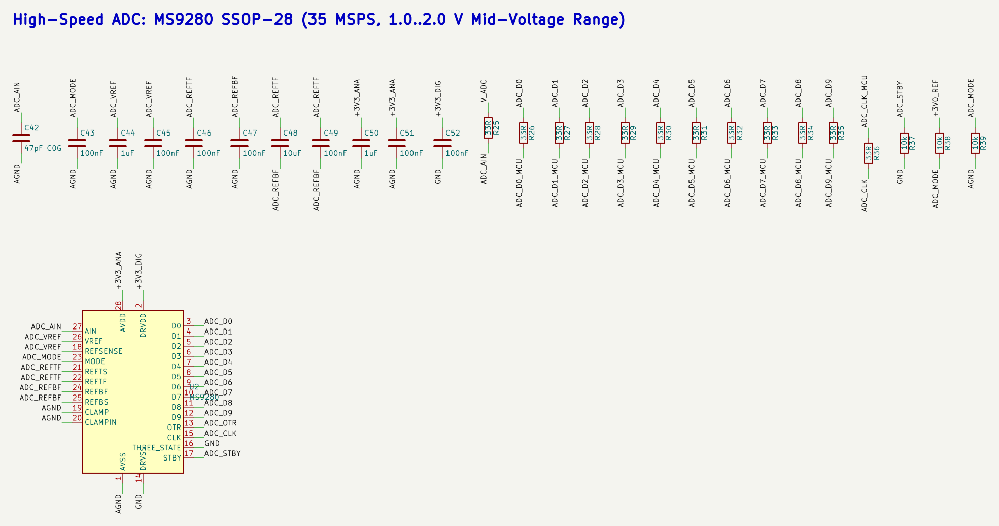

**Logic Probe & 4-Channel Pod:** `TLV3501` comparator, PWM DAC filter, `J3` JST-SH + `SRV05-4` + `SN74LV4T125`

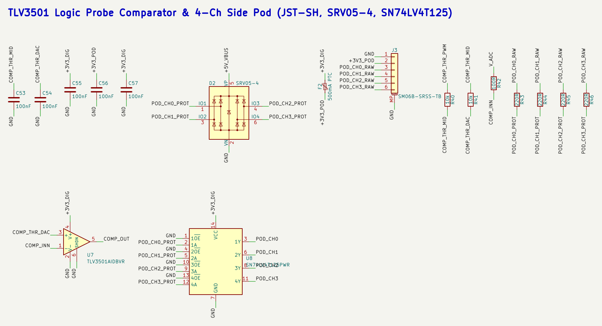

**Power Tree:** Dual `RT9013-33` (`+3V3_DIG`/`+3V3_ANA`), `REF3030` (`+3V0_REF`), `LM2776` + `TPS72301` (`-1V8_ANA`), `R16` Star GND

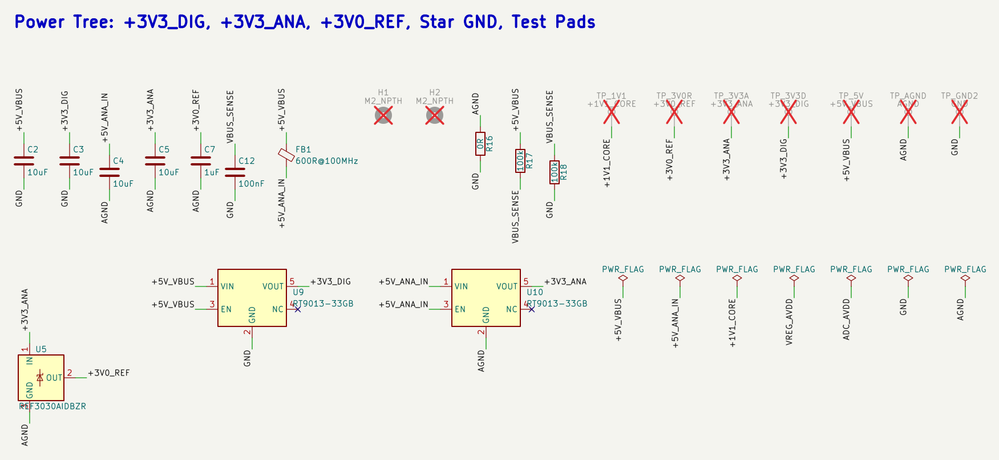

**RP2354B MCU:** QFN-80 pinout, 1.1 V core buck, 12 MHz XTAL, `RUN`/`SWD`/`BOOTSEL`

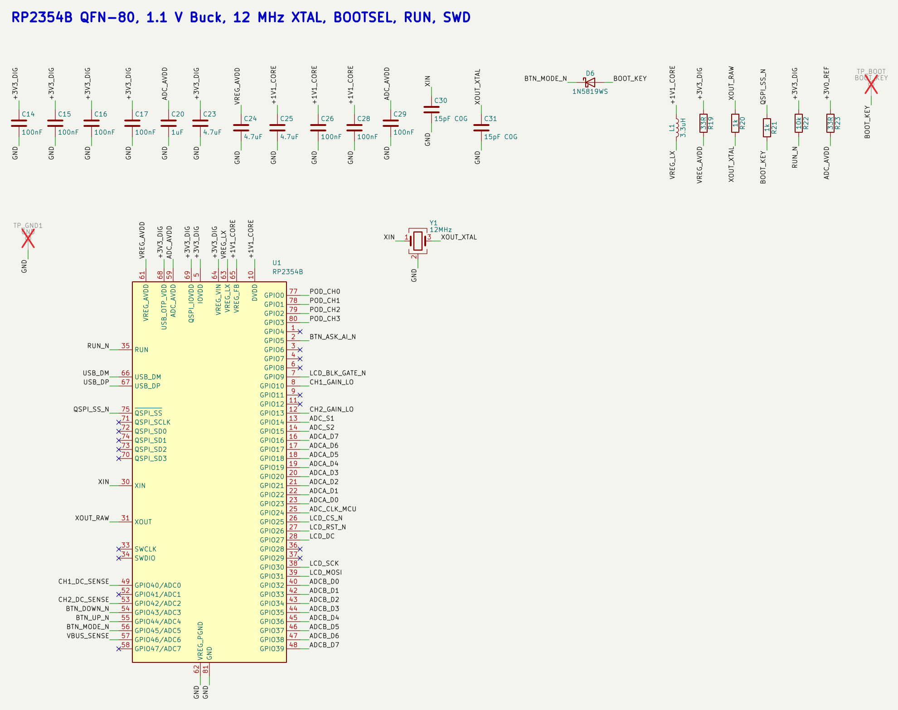

**0.96" IPS LCD & Backlight:** Molex `503480-0800` 8P FPC + `AO3401A` high-side switch

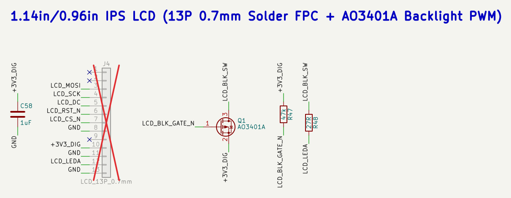

**User Interface:** `ASK_AI` & `MODE/BOOTSEL` buttons + 2 × `WS2812B-2020-V6`

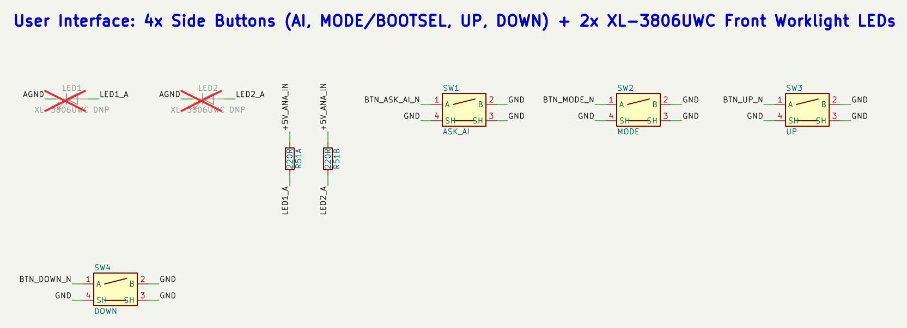

**USB-C:** `TYPE-C-31-M-12`, 5.1 kΩ CC pulldowns, `500 mA` PTC, `SRV05-4` ESD

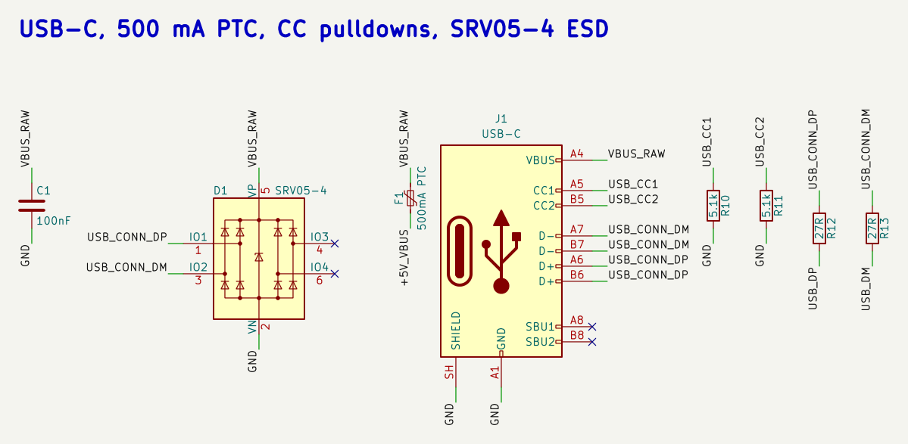

## Circuit board

132 × 15 mm, 4 layers, 1.6 mm thick, single-sided top SMT assembly so all components place cleanly in one pass (with DNP test points `TP_*` on `B.Cu`). Layout flows nose-to-tail from [`hardware/pcb_datum.py`](hardware/pcb_datum.py):

- **Nose (`X = 0..26 mm`):** `J2` M3 probe tip boss surrounded by an inner-plane keepout (`2.0..16.5 mm`, `±5.5 mm`) eliminating capacitive loading on the 1 MΩ node, flanked by `LED1`/`LED2`, the `470 kΩ` HV divider resistors, `BAV199`, `U3`, and front M2 mount `H1` (`X = 19.0 mm`).
- **Grip & Display (`X = 28..78 mm`):** `SW1` (`ASK_AI`) and `SW2` (`MODE`), `J4` 8-pin FPC connector feeding the 0.96" IPS LCD glass (`X = 50..78 mm`, no tall parts beneath glass), `FB1`/`U5`/`U10`/`U11`/`U12` analog power, `U4`/`U6` gain/buffer stage, and `U7` `TLV3501` comparator inside the `AGND` island.
- **ADC, Pod & MCU (`X = 79..132 mm`):** `U2` `MS9280` (`X = 83.0 mm`), damping bank `R26..R37`, side `J3` JST-SH pod + `U8` `SN74LV4T125` + `D2` (`X = 95 mm`), `U1` `RP2354B` (`X = 109.2 mm`), `1.1 V` buck inductor `L1`, `12 MHz` crystal `Y1`, rear M2 hole `H2` (`X = 119.6 mm`), `F1`/`D1`, and `J1` USB-C overhanging 1 mm at `X = 132 mm`.

| Top | Bottom |
|---|---|
| 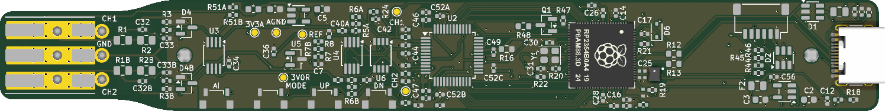 | 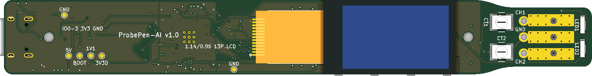 |

| Opposite isometric angle | Nose-to-tail profile |
|---|---|
| 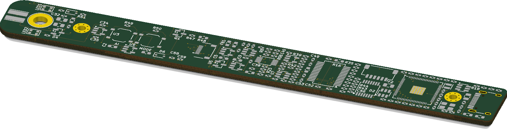 | 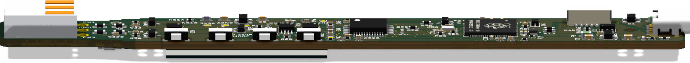 |

**Stackup & Rules:**

| Layer / Feature | Assignment / Constraint |
|---|---|
| `F.Cu` | Primary component pads + primarily vertical/short signal fan-outs (`≥ 0.092 mm` / 3.5-mil baseline, `≥ 0.12 mm` POWER/USB) |
| `In1.Cu` | Unbroken digital `GND` plane (`X = 0.45..131.55 mm`) + isolated `AGND` island (`X = 51.5..82.6 mm`), cleared from `AFE high-Z keepout` (`X = 2.0..16.5 mm`) and `J1` NPTH holes |
| `In2.Cu` | Horizontal long signal buses + routed `+3V3_DIG` / `+3V3_ANA` power trunks (cleared outside `AFE keepout`) |
| `B.Cu` | Horizontal trunk routing + bottom DNP test pads (`TP_*`) |
| High-voltage divider | `/PROBE_TIP` & `/HV_MID` maintain `0.40 mm` minimum clearance to all other nets; `0.30 mm` copper-to-edge margin everywhere |

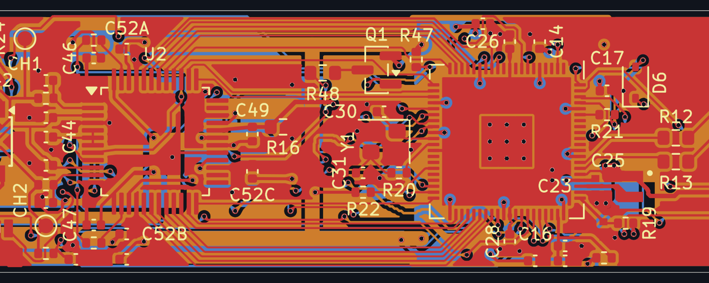

| All signal layers & silkscreen (`F.Cu` + `In2.Cu` + `B.Cu` + `F.SilkS`) |
|---|
| 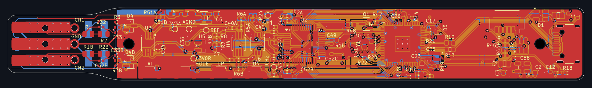 |

| `F.Cu` (top copper) | `In1.Cu` (`GND` plane + `AGND` island + AFE keepout) |
|---|---|
| 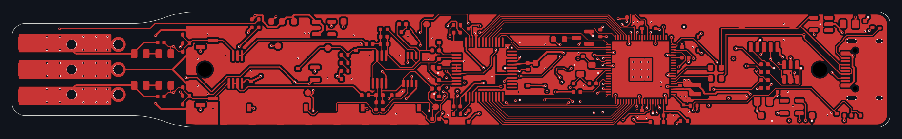 | 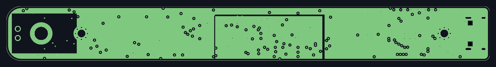 |

| `In2.Cu` (inner horizontal signals & 3V3 trunks) | `B.Cu` (bottom horizontal trunks) |
|---|---|
| 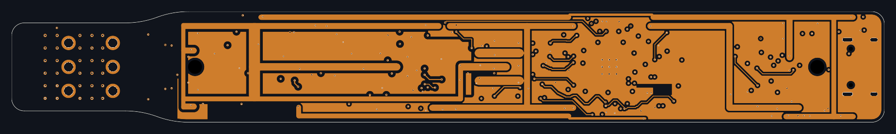 | 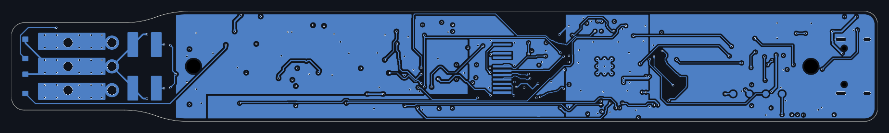 |

| `F.Silkscreen` | `F.Mask` |
|---|---|
| 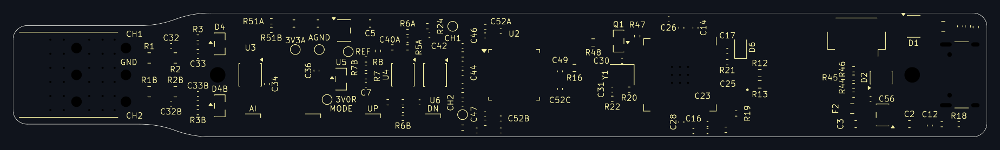 | 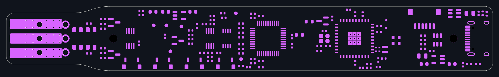 |

## Case

Two-piece parametric pen clamshell generated in Python with **build123d** ([`case/case.py`](case/case.py))
using [`hw/out/board_features.json`](hw/out/board_features.json) so every opening stays locked to
the PCB coordinates:

- **Dimensions:** `135.9 × 18.9 × 11.6 mm` outer pen envelope (`1.6 mm` walls, `0.35 mm` radial PCB clearance, split seam along the top face of the PCB at `Z = 1.60 mm`).
- **Fasteners (no heat-set inserts):** Two M2 screws insert through counterbored `2.2 mm` holes in `top_shell` at `H1` (`X = 19.0 mm`) and `H2` (`X = 119.6 mm`), clamping the PCB and **self-tapping directly into `1.7 mm` plastic pilot bosses** in `bottom_shell`.
- **Openings:** `Ø4.2 mm` nose collar for the M3 stainless tip (`J2`), chamfered `28 × 13.5 mm` IPS display bezel, two `Ø3.8 mm` tactile button apertures (`SW1`/`SW2`), dual `Ø2.0 mm` status LED apertures (`LED1`/`LED2`), side `+Y` opening (`X = 90..100 mm`) for the 6-pin JST-SH pod cable, and tail opening (`X = 132 mm`) for the USB-C plug overmould.

| Exploded assembly (`bottom_shell`, PCB, `top_shell`) | PCB seated inside `bottom_shell` |
|---|---|
| 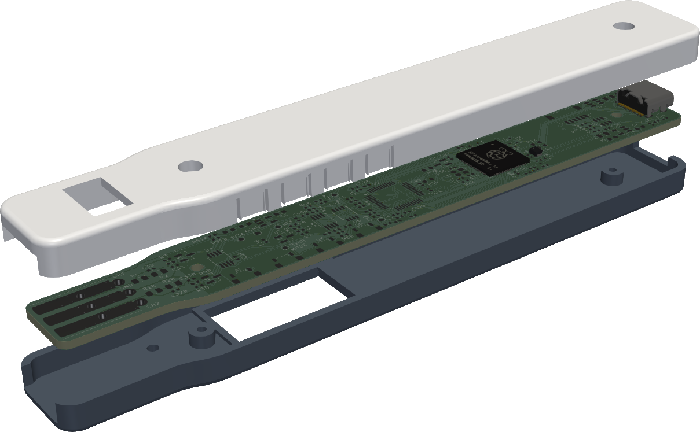 | 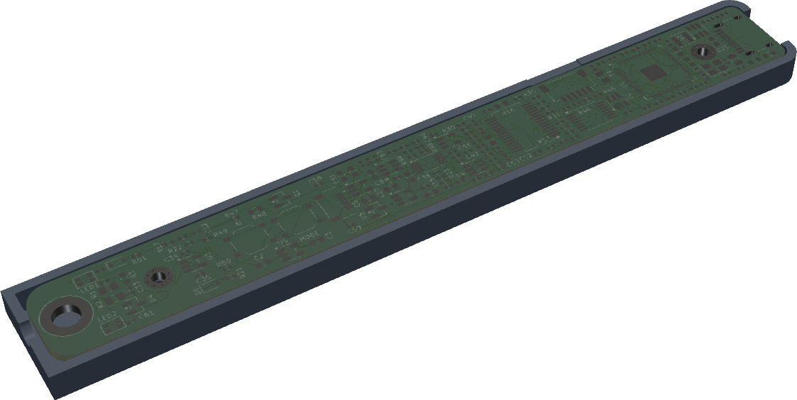 |

| `+Y` side view showing `J3` pod & `J1` USB-C cutouts |
|---|
| 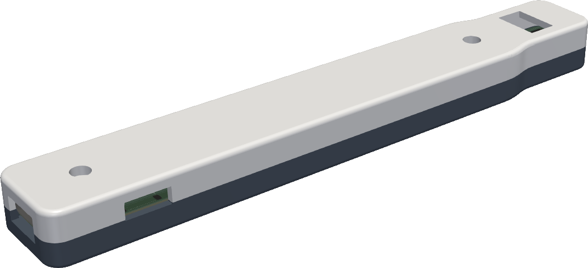 |

Print `top_shell` top-face down and `bottom_shell` back-face down in PETG or ABS (`0.16–0.20 mm`
layer height, 3 walls); STEP and STL meshes are exported to [`case/out`](case/out).

## Input limits and safety

**This instrument is USB ground-referenced (non-isolated).**

- **Working probe tip limits (`J2`):** `±2.5 V` full-scale in `1×` mode and **`±25 V` peak** in `10×` mode. Never connect the probe tip or ground clip to mains AC (`120 V`/`240 V`), unisolated off-line primaries, or high-energy circuits; keep test grounds at USB host ground potential.
- **Overvoltage & ESD:** Input clamping uses `BAV199` diodes behind `940 kΩ` (`2 × 470 kΩ` 0805). USB-C VBUS and the `+3V3_POD` rail are each current-limited by `500 mA` PTC polyfuses (`F1`/`F2`), with `SRV05-4` ESD arrays on both `J1` and `J3`.

## Connectors and test pads

| Ref | Connector | Pinout / Function |
|---|---|---|
| `J1` | USB-C (`TYPE-C-31-M-12`) | `VBUS_RAW`, `USB_CONN_DP/DM`, `CC1/CC2` (`5.1 kΩ` to `GND`), shield `GND` |
| `J2` | M3 SMD Boss (`9774030360R`) | Threads stainless probe needle directly to `/PROBE_TIP` |
| `J3` | 6-pin JST-SH (`SM06B-SRSS-TB`) | `1: GND`, `2: +3V3_POD` (`500 mA` PTC), `3..6: POD_CH0..POD_CH3` (`220 Ω` + ESD + `74LV4T125`) |
| `J4` | 8-pin FPC (`503480-0800`) | `1: LEDA`, `2: GND`, `3: RST_N`, `4: DC`, `5: MOSI`, `6: SCK`, `7: +3V3_DIG`, `8: CS_N` |

**Bottom Test Pads (`B.Cu`):** `TP_5V`, `TP_3V3D`, `TP_3V3A`, `TP_3V0R`, `TP_N1V8`, `TP_1V1`,
`TP_VADC`, `TP_GND1`, `TP_GND2`, `TP_AGND`, `TP_SWCLK`, `TP_SWDIO`, `TP_RUN`, `TP_BOOT`.

## Firmware and calibration

Firmware under [`firmware/`](firmware/) targets the RP2354B in strict ISO C11 plus two PIO programs,
with host-testable core libraries (`afe_cal.c`, `scope_capture.c`, `logic_probe.c`, `lcd_st7735.c`,
`usb_proto.c`) and HAL integration in [`firmware/src/main.c`](firmware/src/main.c):

- **Zero-CPU Acquisition:** [`firmware/ms9280_capture.pio`](firmware/ms9280_capture.pio) clocks `ADC_CLK`
  (`GPIO10`) via side-set and captures 10 bits (`GPIO0..9`) every 2 PIO cycles (35 MSPS at 140 MHz
  sysclk, 3 samples per 30-bit autopush FIFO word); [`firmware/pod_capture.pio`](firmware/pod_capture.pio)
  packs 8 × 4-bit nibbles per word from `GPIO17..20`.
- **Two-Point Self-Calibration:** Compensates 100 ppm 1% Basic divider tolerance and op-amp offset
  for both `1×` and `10×` ranges using `afe_calibrate_two_point()` against two known DC voltages (for
  example `0 V` and `+3.000 V`), plus hysteresis autoranging (`afe_autorange_select()`) and `OTR`
  clipping fallback.
- **USB CDC Protocol:** Supports ASCII commands (`*IDN?`, `MODE <n>`, `GAIN <1|10>`, `THR <mV>`, `CAL`,
  `MEAS?`, `TRIG <code_0..1023>`, `CAPTURE [n]`) and little-endian framed binary waveform packets
  (`[0xAA, 0x55, seq, count_lo, count_hi, samples..., crc16_ccitt_lo, crc16_ccitt_hi]`).

**RP2354B Pin Mapping (verified 1:1 against [`hw/design.py`](hw/design.py) in [`tests/test_firmware.py`](tests/test_firmware.py)):**

| GPIO | Signal | GPIO | Signal |
|---|---|---|---|
| `0..9` | `ADC_D0..ADC_D9` (PIO0 in) | `24` | `LCD_DC` |
| `10` | `ADC_CLK` (PIO0 side-set) | `25` | `LCD_RST_N` |
| `11` | `ADC_OTR` (out-of-range) | `26` | `LCD_BLK_GATE_N` (PWM backlight) |
| `12` | `ADC_STBY` (power-down) | `28` | `LED_DATA` (2 × WS2812B) |
| `16` | `COMP_OUT` (`TLV3501` out) | `29` | `BTN_ASK_AI_N` (`SW1`) |
| `17..20` | `POD_CH0..POD_CH3` (PIO1 in) | `30` | `BTN_MODE_N` (`SW2` / `BOOTSEL`) |
| `21` | `LCD_CS_N` | `31` | `AFE_GAIN_10X` (`RS2227XN`) |
| `22` | `LCD_SCK` (`SPI0`) | `32` | `COMP_THR_PWM` (DAC threshold) |
| `23` | `LCD_MOSI` (`SPI0`) | `40 / 41 / 42` | `ADC0` (`AFE_DC_SENSE`), `ADC1` (`COMP_THR_ADC`), `ADC2` (`VBUS_SENSE`) |

## Ordering at JLCPCB

Fabrication and assembly outputs live in [`hw/out/jlc`](hw/out/jlc):

1. **PCB:** Upload [`hw/out/jlc/gerbers.zip`](hw/out/jlc/gerbers.zip) — **4 layers**, **1.6 mm**, `JLC04161H-7628` impedance/stackup, HASL or ENIG, `≥ 3.5 mil` (`0.092 mm`) trace/space, `0.40 mm / 0.20 mm` vias.
2. **Assembly:** Select **Standard PCBA** (or Economic if part selection supports it), **Top Side** (`F.Cu`), and upload `bom.csv` + `cpl.csv`. Off-board accessories (`FP-096H09A` LCD, M3 probe needle, 6-pin JST-SH pod cable, M2 × 6 mm self-tapping screws) are listed in `accessories.csv`.
3. **Important pre-order check:** Resolve the remaining 16 unrouted connections and drill-to-copper `hole_clearance` DRC items in `hw/route.py` so `kicad-cli pcb drc --schematic-parity` exits with 0 violations, then re-run `hw/export_jlc.py` and verify every IC orientation (`U1` RP2354B pin 1, `U2` MS9280, `U6` RS2227, `D1`/`D2` SRV05-4, `J4` FPC) in JLCPCB's 3D viewer before paying.

Live LCSC part cost snapshot from [`hw/out/jlc/cost.md`](hw/out/jlc/cost.md) (`51` unique parts, `22` Extended @ `$3.00` feeder fee each = `$66.00`; `513` SMT + `14` THT joints/board; 4-layer PCB fab and shipping estimated):

| Boards | Parts | Extended fees | Setup + stencil | Joints | PCB 4L (est.) | Shipping (est.) | Total | Per board |
|---|---|---|---|---|---|---|---|---|
| 10 | $128.83 | $66.00 | $10.78 | $11.14 | $14.00 | $20.00 | **$250.75** | **$25.08** |
| 20 | $252.18 | $66.00 | $10.78 | $22.29 | $22.00 | $25.00 | **$398.25** | **$19.91** |
| 30 | $352.93 | $66.00 | $10.78 | $33.43 | $30.00 | $30.00 | **$523.14** | **$17.44** |
| 50 | $559.00 | $66.00 | $10.78 | $55.72 | $45.00 | $40.00 | **$776.50** | **$15.53** |
| 100 | $1040.60 | $66.00 | $10.78 | $111.43 | $78.00 | $60.00 | **$1366.81** | **$13.67** |

Highest-cost components at qty 30 (`$352.93 / 30` ≈ `$11.76` silicon & connectors/board; `C1509021` `MS9280` stock varies and should be checked before ordering):

| Part | LCSC | Qty | Unit @30 boards |
|---|---|---:|---:|
| `OPA356AIDBVR` (2×) | `C183100` | 2 | $1.07 ea ($2.14 / bd) |
| `TLV3501AIDBVR` | `C193413` | 1 | $1.52 |
| `RP2354B` | `C39843328` | 1 | $1.40 |
| `MS9280` | `C1509021` | 1 | $1.18 |
| `TPS72301DBVR` | `C34678` | 1 | $0.73 |
| `SM06B-SRSS-TB` | `C160405` | 1 | $0.66 |
| `9774030360R` M3 boss | `C5199990` | 1 | $0.53 |
| `SN74LV4T125PWR` | `C90755` | 1 | $0.51 |
| `LM2776DBVR` | `C69527` | 1 | $0.50 |

All discrete resistors (except `R48` 27 Ω LCD backlight dropper) and `100 nF`/`1 µF`/`4.7 µF`/`10 µF` decoupling capacitors use JLCPCB Basic parts (`$0` feeder fee).

## Building it from source

Everything is generated deterministically in WSL (Ubuntu) using KiCad 10 (`~/.local/bin/kicad-python` & `~/.local/bin/kicad-cli`), `.venv` (`build123d`, `pytest`, `pymupdf`, `vtk`, `Pillow`), `gcc`, and `arm-none-eabi-gcc`. Edit the Python/C scripts rather than editing generated KiCad files by hand:

| Step | Command |
|---|---|
| Local symbol/footprint lib | `~/.local/bin/kicad-python hw/gen_lib.py` |
| Schematic & KiCad project | `PYTHONPATH=. python3 hw/gen_sch.py` |
| Board placement, zones & rules | `~/.local/bin/kicad-python hw/gen_pcb.py` |
| 3-layer routing & zone fill | `~/.local/bin/kicad-python hw/route.py` |
| Board STEP & JLC files | `~/.local/bin/kicad-python hw/export_jlc.py` (`--offline` to skip API) |
| Schematic PDF | `~/.local/bin/kicad-cli sch export pdf -o hw/out/schematic.pdf hw/probepen_ai.kicad_sch` |
| Parametric pen enclosure | `.venv/bin/python case/case.py` |
| README block diagram & images | `.venv/bin/python docs/block_diagram.py && .venv/bin/python docs/make_images.py` |
| Full local test suite | `.venv/bin/pytest -v -m "not net"` |

The automated test suite (`151 passed` offline; `pytest` without `-m "not net"` also checks live LCSC API stock) verifies:

- Design self-consistency (`tests/test_design.py`): divider/reference math, AFE gains, PIO GPIO windows, pin uniqueness, power rails;
- Parts & local libraries (`tests/test_parts.py`, `tests/test_lib.py`): datasheet pinouts, KiCad symbol/footprint resolution;
- Schematic (`tests/test_sch.py`): KiCad ERC clean and 100% netlist parity with `hw/design.py`;
- PCB (`tests/test_pcb.py`): 4-layer stackup, AFE keepout, single-sided SMT placement, mechanical datum & courtyard/silk rules;
- Fabrication package (`tests/test_jlc.py`): BOM/CPL parity & Aux origin coordinates, all 4 copper Gerber layers + drills, STEP export, cost table;
- Case fit (`tests/test_case.py`): single-solid watertight STEP/STL meshes, zero PCB collision, connector/button/LED/LCD openings, `1.7 mm` self-tapping pilot bosses;
- Firmware (`tests/test_firmware.py`): 1:1 GPIO header parity with `hw/design.py`, PIO directives, native C11 `ctypes` tests across all 5 modules, and zero-warning `arm-none-eabi-gcc -mcpu=cortex-m33 -mthumb` compilation.

| Folder | Contents |
|---|---|
| `hw/` | Schematic/PCB/library generators, KiCad project, JLC export scripts (`hw/export_jlc.py`, `hw/tools/jlc.py`) |
| `hw/out/` | `board_features.json`, `board.step`, `schematic.pdf`, and `jlc/` fabrication zip/CSVs |
| `hardware/` | Shared mechanical datum (`pcb_datum.py`) and initial architecture notes |
| `case/` | Parametric `build123d` pen enclosure (`case/case.py`) and STEP/STL outputs |
| `firmware/` | RP2354B PIO programs, CMake build, headers (`include/`), and C11 sources (`src/`) |
| `docs/` | Image/diagram generator scripts (`docs/make_images.py`, `docs/case_views.py`, `docs/block_diagram.py`) and `docs/img/` |
| `tests/` | `pytest` verification across hardware, exports, CAD case fit, and firmware |

## Licence

GPL-3.0: hardware design files, CAD, firmware and scripts alike. See [LICENSE](LICENSE).
