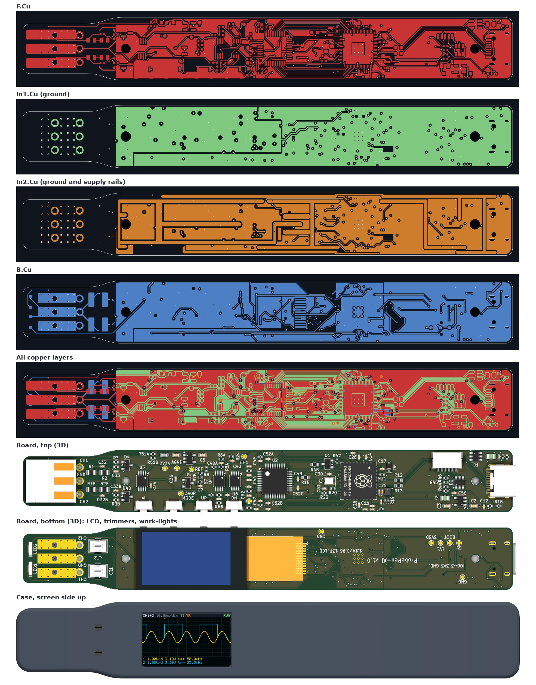
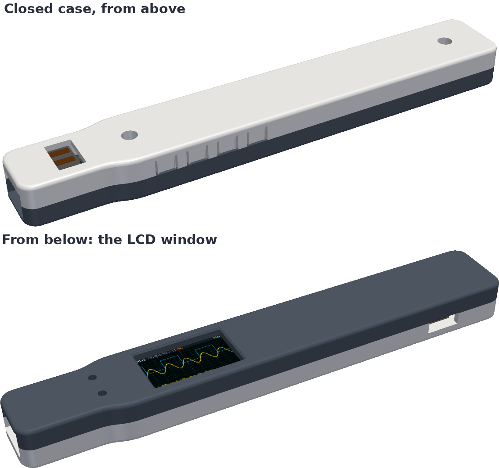
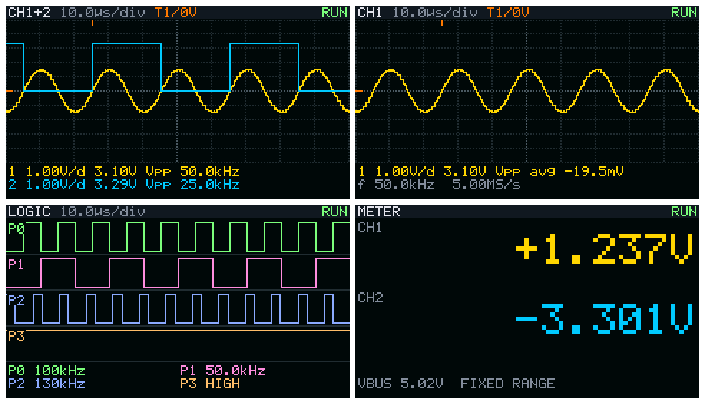

# ProbePen-AI

A USB-C pen-shaped two-channel oscilloscope built around an **RP2354B** and an **AD9288** dual 8-bit
ADC, with an IPS LCD on the underside, four side buttons, a 4-channel logic pod and a WAGO push-in
terminal at the nose for the two probe inputs. Everything (schematic, placement, routing,
fabrication files, case and firmware) is generated by scripts in this repository.

> **Status (2026-11-27):** re-laid out and fully routed on the `relayout` branch: KiCad DRC with
> schematic parity reports 0 errors and 0 unconnected items (the only warnings are the open ends of the
> In2 supply rails, by design), ERC is clean and all 149 offline tests pass. 2.5 m of track, 223 vias.
> About 160 mm of slow signals (gain-switch and DC-sense lines, two buttons, pod and LCD control) use
> the inner layers as jumpers, the longest 27 mm. The case fits the routed board, and the firmware
> has its full main loop and user interface (host-tested; not yet built against the Pico SDK).
> No board has been made or bench-tested yet.

**Try it in the browser: [ProbePen-AI simulator](https://clowrey.github.io/probepen-ai/).** The page runs the
firmware's own user interface (`firmware/src`, compiled to WebAssembly) on simulated probe signals. You
can press the side buttons, connect preset signals (UART, PWM, fast edges, glitches, over-range, a 12 V
rail, an SPI bus on the logic pod), and drive it from a host app over the real USB command protocol:
capture, measure, calibrate, and receive ASK snapshots. The simulated hardware is in [`sim/sim.c`](sim/sim.c).

| | |
|---|---|
| **MCU** | RP2354B (QFN-80, 0.4 mm pitch): dual Cortex-M33 at 150 MHz, 2 MB stacked flash, 12 PIO state machines, on-chip 1.1 V core buck (layout copied from the owner's CellKeeper board), 12 MHz crystal |
| **Scope ADC** | AD9288 (LQFP-48, hand-soldered, not placed by the assembler): two 8-bit channels, read by one PIO program as one 32-bit word per sample, clocked by PIO side-set at up to 75 MSPS (150 MHz / 2 / integer divider, set by the timebase) |
| **Front end** | Per channel: 940 kΩ (2 × 470 kΩ) with 1 pF into a 100 kΩ / 51 kΩ divider biased from the 3.000 V reference (rests at 0.978 V), BAV199 clamp, RS8752 buffer, RS8752 inverting gain stage pivoting on REF_MID (0.978 V), 74LVC2G66 gain switch. High range about ±5 V, low range about ±26 V |
| **References and supplies** | REF3030 (3.000 V), two RT9013-33 LDOs (`+3V3_DIG`, and `+3V3_ANA` behind a 600 Ω ferrite); the analog ground island joins digital ground at one 0 Ω link (R16) |
| **Logic pod** | 6-pin JST-SH side connector on GPIO0..3 (the 5 V tolerant pins), PTC-fused 3.3 V out, SRV05-4 ESD |
| **Display and buttons** | 13-pin 0.7 mm LCD flex soldered to pads on the bottom side (SPI1), AO3401A backlight switch; four side-actuated buttons (ASK, MODE/BOOTSEL, UP, DOWN); two front white work-light LEDs |
| **Board** | 138 × 17.6 mm, tapered to 14 mm at the nose, 4 layers (JLC04161H-7628), 1.6 mm, single-sided assembly on the top |
| **Case** | Two-piece build123d pen shell, 142 × 21.5 × 12.2 mm; screws self-tap into the plastic (no inserts) |

## Scope specifications

These figures come from the circuit values, the datasheets and the firmware as it is written today
(`firmware/src/app.c`, `main.c`). No board has been measured yet. Rows marked *possible* need a
firmware change but no hardware change.

| | |
|---|---|
| **Channels** | 2, sampled at the same instant (both AD9288 encode pins are driven from one MCU clock pin) |
| **Resolution** | 8 bits. One step is 39 mV on the ±5 V range and 214 mV on the ±26 V range |
| **Ranges** | ±5.0 V (high gain) and about ±26 V (low gain), chosen per channel, automatically or fixed. Auto-range switches up at 90 % of ±5 V or when the ADC reports over-range, and back down below 70 % |
| **Input** | About 975 kΩ, DC coupled. The divider is compensated (1 pF over 22 pF plus an optional 2–10 pF trimmer, `CT1`/`CT2`) |
| **Bandwidth** | Expected to be limited by the 31 MHz anti-alias filter (51 Ω × 100 pF) in front of the ADC. The 250 MHz RS8752 buffers are not the limit. Not yet measured |
| **Maximum sample rate** | 75 MS/s on each channel at once (150 MHz system clock ÷ 2 PIO cycles per sample). The AD9288-80 is rated to 80 MS/s, so overclocking the MCU to 160 MHz would give 80 MS/s (*possible*) |
| **One channel faster?** | No. Showing one channel (CH1 or CH2 mode) does not raise the rate, because both channels share one encode clock. Interleaving the two channels to 150 MS/s would need a second clock pin 180° out of phase and the same signal on both inputs: a board change |
| **Sample rate per timebase** | 100 ns/div to 1 µs/div: 75 MS/s. 2 µs: 25 MS/s. 5 µs: 10.7 MS/s. 10 µs: 5 MS/s. 20 µs: 2.4 MS/s. All rates are 75 MHz ÷ an integer, so there is no clock jitter from fractional dividers |
| **Peak detect** | At 50 µs/div and slower, the ADC keeps running at 2.5 MS/s. Every 4 to 2048 samples are reduced to a minimum and a maximum, so pulses of 0.4 µs or longer still show at 50 ms/div |
| **Record length (today)** | 4096 samples per channel per capture (16 KB DMA buffer). Each capture holds about 4 screen widths, used for the trigger search: 512 samples (6.8 µs) at 100 ns/div, 3000 samples (40 µs) at 1 µs/div, about 2000 samples at slower timebases (0.8 ms at 20 µs/div, 0.4 s at 10 ms/div), and 4096 samples (1.7 s) at 50 ms/div |
| **Record length (*possible*)** | The RP2354B has 520 KB of RAM, and today's buffers use about 110 KB. Today each sample pair takes a 32-bit word. With 384 KB of capture RAM that is about 96 k samples per channel (1.3 ms at 75 MS/s). If a second PIO state machine read channel B, each channel would pack into its own 8-bit stream. That gives about 196 k samples per channel (2.6 ms at 75 MS/s), or about 390 k samples (5.2 ms) for one channel alone |
| **Trigger** | Software trigger on the captured record: rising or falling edge, on CH1 or CH2, with 3 codes of hysteresis. The trigger point sits a quarter of the way across the screen, so 25 % of the screen is pre-trigger. If no edge is found, the display free-runs (like *Auto*) and the trigger label turns grey |
| **Trigger level** | Any 8-bit code, 0–255. Holding UP/DOWN moves it 4 codes at a time (157 mV on ±5 V, 0.86 V on ±26 V); the USB command `TRIG n` sets an exact code. It is drawn as a tick on the left edge and shown in volts in the header |
| **Trigger timing** | The trigger lands on the first sample past the level, with no interpolation between samples, so the trace can shift by up to one sample period (13.3 ns at 75 MS/s). Captures are taken back to back, and while a frame is being drawn and sent to the LCD (about 15–20 ms per frame, estimated), new edges are not seen. It is a display trigger, not a hardware trigger that catches every event |
| **Timing accuracy** | Set by the ±10 ppm 12 MHz crystal. The frequency readout averages every crossing in the record, so its error is about one sample period divided by the record's duration |
| **Voltage accuracy** | Offset: `CAL` with both tips on AGND zeroes both ranges, and the result is stored in flash. Gain: uncalibrated, the result depends on 1 % resistors, the 0.2 % REF3030 and the AD9288's own gain error, so expect a few percent. A two-point gain calibration routine exists (`afe_calibrate_two_point`) but no command is wired to it yet. Linearity is about ±½ LSB typical (AD9288 datasheet) |
| **DC meter mode** | Reads each gain stage through the RP2354B's 12-bit ADC (`CHx_DC_SENSE`, 10 kΩ / 10 nF), slow but finer than the 8-bit scope ADC, plus VBUS |
| **Logic pod** | 4 inputs (5 V tolerant), sampled at the scope's rate for the timebase, up to 75 MS/s, 4096 samples. Shows each line's level and edge count |
| **USB** | Full speed (12 Mbit/s) CDC serial. Today the link sends a block on request: `CAPTURE n` (up to 4096) or a long press of ASK sends both channels as framed binary with a CRC, at 16 bits per sample, so a full 2 × 4096 record is 16 KB (about 15–20 ms). Continuous real-time streaming is not written yet. At the 0.8–1 MB/s a full-speed CDC link manages in practice, with 8-bit samples, it would carry about 400–500 kS/s per channel with both channels, or about 1 MS/s with one (*possible*) |

## How it works

The signal runs nose to tail. The two probe inputs enter at the WAGO terminal (`J5`), pass the
high-voltage dividers, clamps and buffers on the analog ground island, and reach the ADC (`U2`) at
x ≈ 71 mm. Its two 8-bit data buses run to the MCU (`U1`, x ≈ 94.5 mm) in pin order, so they never
cross. The LCD bus, buttons, sense lines and logic pod connect to the MCU's other sides, and USB-C
sits at the tail.

- **Front end.** 0 V at a tip sits at ADC mid-scale on both ranges, because the gain stages pivot on
  the same voltage the dividers rest at (`REF_MID`). The input buffer accepts 0.05 to 2.2 V, which
  sets the usable ranges. The gain stage inverts; the firmware flips the codes back. A floating tip
  sits at about +1 V (the divider bias) but reads 0 V, and a grounded tip sources about 1 µA into the
  circuit under test. The full wiring list is
  [`hardware/SCHEMATIC_WIRING_SPEC.md`](hardware/SCHEMATIC_WIRING_SPEC.md), generated from `hw/design.py`.
- **ADC capture.** `ADCA_D7..D0` are on GPIO16..23 (bit-reversed, to keep the bus uncrossed) and
  `ADCB_D0..D7` on GPIO32..39, so with the PIO GPIO base at 16 a single `in pins, 32` reads both
  channels. `ADC_CLK` (GPIO24) is driven by side-set.
- **DC sense.** Each channel's gain-stage output also feeds an RP2354B ADC input (GPIO40, GPIO42)
  through 10 kΩ and 10 nF, for a slow DC reading. `VBUS_SENSE` is on GPIO46.

## Circuit board

The layout rules (inner layers, vias, widths, critical nets, the MCU fan-out) are written down in
[`docs/ROUTING_GUIDE.md`](docs/ROUTING_GUIDE.md). In short:

- **Stackup:** `F.Cu` parts and signals; `In1.Cu` ground (GND, with the AGND island under the front
  end); `In2.Cu` ground plus the supply rails as wide tracks (`hw/rails.py`); `B.Cu` signals, the LCD
  pads and a 3.3 V pour under the MCU.
- **Vias:** 0.40 / 0.20 mm everywhere, none in pads, 0.25 mm hole-to-copper (JLC lists 0.254 mm
  via-to-track for multilayer boards).
- **Nose:** no copper pours under the probe pads and dividers and no inner-layer copper there; one
  planned AGND trace ties the terminal, LEDs and tip capacitors back to the analog ground island.
- **MCU:** the core regulator (switch node, inductor, input and output capacitors, local pours and
  the inner-layer cut-out) is copied from CellKeeper. Inside the pad ring only supply and ground
  tracks are allowed, as a board rule that KiCad's DRC checks. Slow pins fan out with a short stub
  to a via just outside the chip.

### How it is routed

1. `hw/design.py` → `hw/gen_sch.py` → `hw/gen_pcb.py`: circuit, schematic, placement and zones.
2. `hw/tools/plan_routes.py … critical`: a grid planner in this repo lays the nets whose geometry
   matters (front end, USB pair, crystal, ADC buses, supply-rail vias, MCU fan-out) together with
   the fixed escapes in `hw/escapes.py`. These are locked.
3. `hw/tools/groute/run.sh`: the open-source router
   [KiCadRoutingTools](https://github.com/drandyhaas/KiCadRoutingTools) routes the rest one group of
   nets at a time (`route.py --nets …`), each group with its own layers and keep-outs. Several group
   orders run in parallel and the best is kept. Supplies and grounds follow; the router's few
   too-close vias are nudged clear, and stranded pour pieces get a stitching via
   (`hw/tools/stitch_islands.py`).
4. The result is frozen into `hw/routes.py`, and `hw/route.py` rebuilds the board from it.

## Case

[`case/case.py`](case/case.py) builds the two-piece pen shell in build123d from
[`hw/out/board_features.json`](hw/out/board_features.json), so every opening follows the board.
Screws self-tap into pilot holes in the plastic; there are no heat-set inserts.

Every part on the board has a 3D model: the RP2354B, USB-C and inductor use vendor STEP files, and the
rest are built in build123d from each footprint's pads (`hw/gen_3d.py`), including the hand-fitted
AD9288, LCD, work-lights and trimmers, which the renders show fitted.

- The outline follows the board, including the 14 mm nose and its S-curve taper.
- The nose has a front window over the WAGO wire entries and the two work-light LEDs, and a window
  on top over the terminal's release push-buttons.
- The LCD sits on the bottom of the board, so its viewing window is in the bottom shell, with a
  ledge under the glass rim.
- Each side button gets a flexure tab cut into the side wall that presses the switch plunger.
- Two holes in the bottom shell reach the input trimmer capacitors.
- The 12.2 × 21.5 mm cross-section is set by the WAGO terminal (4.5 mm tall) on top and the LCD glass
  below.

Printing: `case/out/top_shell.stl` and `bottom_shell.stl`, each with its flat outer face on the bed
(the top shell upside down), no supports. Walls are 1.6 mm (four 0.4 mm perimeters). Two M2 × 8 mm
pan-head self-tapping screws hold it together through the board's mounting holes.

## Input limits and safety

The instrument is referenced to USB ground; it is not isolated. Keep both probe inputs within about
±26 V on the low range and ±5 V on the high range, and never connect it to mains or to circuits that
are not referenced to the USB host's ground.

## Connectors and test pads

| Ref | Part | Use |
|---|---|---|
| `J1` | USB-C (HRO TYPE-C-31-M-12) | power, USB full speed, 5.1 kΩ CC pull-downs |
| `J3` | JST-SH 6-pin, side | logic pod: 1 GND, 2 fused 3.3 V, 3..6 POD_CH0..3 |
| `J4` | LCD flex pads, 13-pin 0.7 mm, bottom side | IPS panel on SPI1 (CS, RST, DC, SCK, MOSI, backlight) |
| `J5` | WAGO 2060 3-pole, nose | CH1, AGND, CH2 |

Test pads: `TP_5V`, `TP_3V3D`, `TP_3V3A`, `TP_3V0R`, `TP_1V1`, `TP_GND1`, `TP_GND2`, `TP_AGND`,
`TP_BOOT`, `TP_CH1`, `TP_CH2`, `TP_REFM`. This revision has no SWD or RUN pads: the MCU is programmed
over USB (hold MODE/BOOTSEL), and the pads had no room beside the crystal and the LCD lines.

## Firmware

[`firmware/`](firmware/) is C11 with two PIO programs:

- [`ad9288_capture.pio`](firmware/ad9288_capture.pio): one sample per two PIO cycles, both channels
  in one word, moved to RAM by DMA; `scope_unpack_ad9288()` splits them and bit-reverses channel A.
- [`pod_capture.pio`](firmware/pod_capture.pio): the four pod inputs on GPIO0..3, eight 4-bit samples
  per word.
- [`src/main.c`](firmware/src/main.c): one capture is always in flight (PIO + DMA); meanwhile the
  loop reads the buttons, the DC-sense ADC and the USB command line. Each finished capture is
  measured, drawn, and sent to the LCD over SPI1 with 16-bit DMA. At 50 µs/div and slower the scope
  runs in peak detect: the ADC keeps sampling at 2.5 MS/s into a DMA ring and the loop keeps the
  minimum and maximum of each slot, so pulses and fast signals still show at slow timebases
  instead of aliasing.
- [`src/app.c`](firmware/src/app.c): the whole user interface, with no hardware calls, so it runs and
  is tested on the host. It holds the modes, timebases (integer PIO dividers, 100 ns to 50 ms/div),
  trigger, auto-ranging, button debounce and long-press, USB commands and screen drawing.
- Other host-testable modules: front-end calibration (8-bit codes, mid-scale 128), trigger and
  measurement, LCD (5×7 font; 1.14" ST7789 by default, `-DPROBEPEN_LCD_096` for the 0.96" ST7735),
  logic helpers and a framed USB protocol.

The screens above are the firmware's own drawing code fed synthetic captures
(`.venv/bin/python docs/fw_ui_preview.py`): both channels, one channel, logic pod and DC meter.

| Button | Short press | Held |
|---|---|---|
| ASK | run / hold | send the measurements and the screen's samples to the host (`ASK …` line + frames) |
| MODE | next mode: CH1+2, CH1, CH2, LOGIC, METER | trigger source and slope |
| UP / DOWN | slower / faster timebase | trigger level up / down (repeats) |

USB (CDC serial, one command per line): `*IDN?`, `MODE n` (0..4), `TB n`, `GAIN 0|1|10` (0 = auto
range), `TRIG code`, `RUN 0|1`, `CAL` (zero the offsets with the inputs shorted; kept in the last flash sector), `MEAS?`, `CAPTURE n`
(replies `OK n`, then one binary frame per channel: `AA 55 seq count16 samples16… crc16`).
[`host/probepen.py`](host/probepen.py) speaks this protocol from a PC: `idn`, `meas`, `capture N`
(CSV), `send "<command>"`, and `ask`, which waits for ASK presses and returns each snapshot for an
assistant to look at.

`firmware/include/probepen_pins.h` is generated from the GPIO map in `hw/design.py`
(`python -m hw.tools.gen_pins_h`), and the tests check it against that map. A full Pico SDK build has
not been run yet; the tests compile every source natively and for Cortex-M33, and type-check the
hardware code path against the SDK 2.x signatures (`tests/fw_stubs`).

To check on the first board:

- The LCD window offsets and orientation (`LCD_X_OFFSET`, `LCD_Y_OFFSET`, `MADCTL`).
- The DC-sense scaling against a meter.
- ADC capture at 75 MS/s (`TB 0`) with a known ramp. The PIO reads the bus through the input
  synchronisers about two system clocks late, so look for bit errors. If there are any, try input
  sync bypass on GPIO16-23 and 32-39 or a slower top rate.
- `OVR` on the screen (or `OVR=YES` in `MEAS?`): the capture lost samples, either a stalled PIO FIFO
  or peak detect falling behind its DMA ring.
- The RP2354 stepping. On A2 parts, erratum E9 can latch a pad with its pull-down on, so the firmware
  turns the pod inputs' pulls off; floating pod inputs then read noise.
- That a UF2 drag-and-drop leaves the stored calibration alone. It sits one sector below the top of
  flash, away from picotool's 0x10FFFF00 block.

| GPIO | Signal | GPIO | Signal |
|---|---|---|---|
| 0..3 | POD_CH0..3 | 24 | ADC_CLK (side-set) |
| 5 | BTN_ASK_AI_N | 25, 26, 27 | LCD_CS_N, LCD_RST_N, LCD_DC |
| 9 | LCD_BLK_GATE_N | 30, 31 | LCD_SCK, LCD_MOSI (SPI1) |
| 10, 13 | CH1_GAIN_LO, CH2_GAIN_LO | 32..39 | ADCB_D0..D7 |
| 14, 15 | ADC_S1, ADC_S2 | 40, 42 | CH1_DC_SENSE, CH2_DC_SENSE (ADC0, ADC2) |
| 16..23 | ADCA_D7..D0 | 43, 44, 45 | BTN_DOWN_N, BTN_UP_N, BTN_MODE_N |
| | | 46 | VBUS_SENSE (ADC6) |

## Ordering

`hw/export_jlc.py` writes the Gerbers, BOM and placement file for JLCPCB assembly to
[`hw/out/jlc/`](hw/out/jlc/), and [`cost.md`](hw/out/jlc/cost.md) with live JLC prices and stock:
about $9.80 per board for 30 assembled boards (2026-11-27), every part in stock. The AD9288, the LCD
and the button caps are not in that figure: the AD9288 and the LCD are hand-soldered
(`accessories.csv`).

## Building it from source

In WSL (Ubuntu) with KiCad 10 (`kicad-python`, `kicad-cli`), the project `.venv` (build123d,
pytest), `gcc` and `arm-none-eabi-gcc`:

| Step | Command |
|---|---|
| Schematic | `.venv/bin/python -m hw.gen_sch` |
| 3D models of the parts (build123d) | `kicad-python hw/tools/dump_fp_geometry.py && .venv/bin/python -m hw.gen_3d` |
| Board placement and zones | `kicad-python hw/gen_pcb.py` |
| Board from the frozen routing | `kicad-python hw/route.py` |
| Re-route from scratch | `KRT=<KiCadRoutingTools checkout> hw/tools/groute/run.sh` |
| Pin header for the firmware | `.venv/bin/python -m hw.tools.gen_pins_h` |
| Case | `.venv/bin/python case/case.py` |
| Images | `kicad-python docs/render_board.py`, then `docs/make_images.py`, `docs/fw_ui_preview.py`, `docs/case_views.py`, `docs/composite.py` (each with `.venv/bin/python`) |
| Web simulator | `sim/build.sh` (clang, lld and wasi-libc; writes `sim/site/probepen.wasm`, which is committed and published by `.github/workflows/pages.yml`) |
| Tests | `.venv/bin/pytest -m "not net"` |

## Licence

GPL-3.0: hardware design files, CAD, firmware and scripts alike. See [LICENSE](LICENSE).
